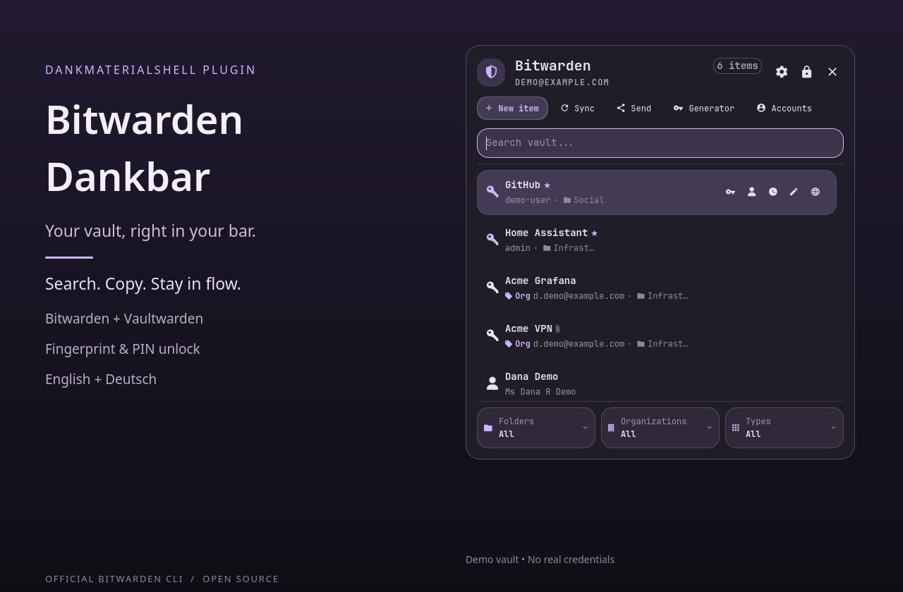

# Bitwarden Dankbar

> Version 1.11.6-dms.2: security core ported from upstream 1.11.6. Build all three
> helpers after updating: `./scripts/build-helpers.sh`. DMS runs only local builds;
> a missing or failed vault helper keeps the vault locked.

The vault now lives in a separate process with core dumps disabled. The panel
receives a redacted list and loads item secrets only when needed. Protected items
require the master password before revealing, copying, editing, or exporting.
Master passwords and PINs use a separate `pinentry` window by default.

Runtime additions: `pinentry` (preferably `pinentry-qt`) and `argon2` for quick
unlock; Rust/Cargo is needed to build the helpers. On Arch, install these using
your package manager, then run the build script above. Fingerprint verification
still uses DMS's `assets/pam/fprint`. Quick-unlock data is encrypted and sealed to
this machine; existing entries migrate when successfully used. Do not delete
legacy keyring entries manually during migration.

A six-digit PIN still has limited offline resistance: upstream estimates about
16 hours to try all values on a 16-thread laptop; eight digits take about
2 months on that hardware. These are estimates, not a guarantee; use a longer PIN.
FIDO2 is optional and requires an existing pam-u2f registration in
`/etc/fido2/fido2`; this plugin does not enroll keys or modify system PAM.

SSH grants are scoped to the key, program, signature purpose, and (for login)
the bound server. Forwarded or unrecognized requests permit a single signature
only. The optional **until screen lock** grant is retained and is revoked by
DMS screen locking even when automatic vault locking is disabled.


A Bitwarden and Vaultwarden plugin for DankMaterialShell, maintained by [coldi1337](https://github.com/coldi1337). Based on [Elevate08/qs-bitwarden-cli](https://github.com/Elevate08/qs-bitwarden-cli) by David Spencer. MIT licensed.

Search, copy and manage a Bitwarden or Vaultwarden vault directly in a Quickshell panel. The official `bw` CLI performs vault operations. The plugin supports logins, secure notes, cards, identities, TOTP, folders, organizations, the password generator, Bitwarden Send and an optional SSH agent.



The preview renders the plugin's actual QML controls with fictional demo data in an isolated, non-interactive scene. Processes, keyring access and IPC are disabled in that scene. The numbered screenshots inherited from upstream show its Omarchy UI with fictional demo data.

## Language

The interface includes English and German. It follows the language selected in DMS, including German regional locales such as `de_AT` and `de_DE`. English is the fallback for untranslated text; external CLI diagnostics may also remain English. Vault contents are never translated.

Translations are shipped in `translations/de.json` and loaded through DMS's plugin translation service. No POEditor enrollment is needed for these local translations.

## Requirements

- DankMaterialShell **1.6.0 or newer** and Quickshell.
- The official Bitwarden CLI (`bw`) and `jq`.
- `wl-copy` and `wl-paste` from `wl-clipboard` for bounded clipboard operations.
- Locally built vault, unlock-key and SSH helpers (`./scripts/build-helpers.sh`).
- `pinentry-qt` (or another `pinentry`) and `argon2` for quick unlock.
- A running Secret Service provider (for example `gnome-keyring`) and `secret-tool` for remembering sessions, PIN and fingerprint unlock. Installing `libsecret` alone provides only the client, not a keyring service.
- `gdbus` and `systemd-inhibit` for the suspend monitor.
- An enrolled fingerprint and DMS's `assets/pam/fprint` configuration for fingerprint unlock.

The setup screen identifies missing required dependencies. On Arch, its install action opens a terminal and runs `sudo pacman -S --needed` for the selected packages. On other distributions, install the named packages with the distribution's package manager.

## Platform support

The core vault panel uses DMS and the tools listed above. Interactive testing has been on Arch Linux with Hyprland. Automatic suggestions for the active window currently use `hyprctl` and are available on Hyprland; manual vault search works independently of that feature. On distributions without `pacman`, install dependencies manually. Fingerprint unlock additionally requires compatible hardware, enrollment and the DMS PAM configuration.

## Installation

The plugin is listed in the DMS plugin registry. For a direct installation from this repository:

```sh
mkdir -p "${XDG_CONFIG_HOME:-$HOME/.config}/DankMaterialShell/plugins"
git clone --branch main https://github.com/coldi1337/dms-bitwarden-cli.git \
  "${XDG_CONFIG_HOME:-$HOME/.config}/DankMaterialShell/plugins/bitwarden"
"${XDG_CONFIG_HOME:-$HOME/.config}/DankMaterialShell/plugins/bitwarden/scripts/build-helpers.sh"
dms ipc call plugin-scan scan
dms ipc call plugins enable bitwarden
```

Then add **Bitwarden Dankbar** to your DankBar layout in DMS settings. If the destination already exists, update that installation instead of cloning over it.

To update a clean installation:

```sh
git -C "${XDG_CONFIG_HOME:-$HOME/.config}/DankMaterialShell/plugins/bitwarden" pull --ff-only
"${XDG_CONFIG_HOME:-$HOME/.config}/DankMaterialShell/plugins/bitwarden/scripts/build-helpers.sh"
dms restart
```

Restarting DMS loads updated QML imports and locks the plugin's active vault. Your CLI account remains signed in.

## Sign in and use the vault

Click the shield/lock icon in DankBar. Choose US, EU, or a custom server URL for Vaultwarden. The panel supports email/password, two-factor challenges and API-key login. Its terminal-login action delegates interactive login prompts to `bw`.

Common shortcuts while the item list is focused:

| Key | Action |
| --- | --- |
| `/` | Search |
| Up / Down, `j` / `k` | Select an item |
| Enter | Copy password, or open a non-login item |
| `u` | Copy username |
| `m` | Copy TOTP code |
| `e` | Open details / edit |
| `f`, `o`, `t` | Folder, organization and type filters |
| `g` | Password generator |
| `n` | New item |
| `s` | Settings |
| `r` | Sync |
| `l` | Lock |
| Escape | Back / clear search / close |

While typing in the search field, Alt plus the corresponding key runs a shortcut. Password copies use `wl-copy --sensitive`; the configurable clipboard timer clears them. The optional TOTP follow-up can replace a copied password with its current TOTP.

Right-clicking the bar icon locks an unlocked vault, or opens a locked vault. Both horizontal and vertical bars are supported. A single daemon owns the vault and IPC, shared by every bar, so multiple monitors do not create competing sessions.

### Vault layout

The header keeps the vault name, account and filtered item count readable.
Settings, lock and close stay in the header; labeled New item, Sync, Send,
Generator and Accounts actions occupy a separate wrapping toolbar.
The virtualized list gives names and subtitles more room, with compact quick
actions on the selected/hovered row. Folder, organization and type filters use
equal-width cards with separate labels and values; their full values remain in
tooltips. Existing keyboard shortcuts and protected-item checks are unchanged.

Inputs use a single inline hint rather than a Material floating label, so an
external form label is not duplicated and a filled input does not show its hint.

The fixture renderer can also check actual rendered bounds at compact and default
widths, without opening your real vault:

```sh
python3 demo/render-dms-preview.py --check-layout --panel-width 450 --output /tmp/bitwarden-450.png
python3 demo/render-dms-preview.py --check-layout --panel-width 520 --output /tmp/bitwarden-520.png
python3 demo/render-dms-preview.py --test-ui --controls-style Material
```


## Fingerprint unlock

The DMS port uses the **same fingerprint-only PAM configuration as DMS's lock screen**:

```
<active DMS shell directory>/assets/pam/fprint
```

No Omarchy PAM service or additional `/etc/pam.d` file is needed. The setup probe checks this configuration and an enrolled finger. Fingerprint verification is performed by Quickshell's PAM integration and `pam_fprintd`.

1. Unlock the vault normally.
2. Open the plugin's settings, then **Security → Unlock with fingerprint**.
3. Enter the Bitwarden master password in the plugin's setup form once.
4. Lock and reopen the vault, then touch the sensor.

If saving the master password reports that the OS keyring is unavailable, install/start a Secret Service provider and create or unlock its default keyring. The keyring password belongs in the desktop prompt, not in this plugin. Automatic keyring unlock at desktop login depends on the session/PAM configuration; fingerprint enrollment alone does not unlock the keyring.

Fingerprint unlock is **off by default**. Quick unlock stores an encrypted,
machine-sealed envelope in Secret Service. Fingerprint authorization is a UI
policy: another process running as your user may still access the unlocked
keyring and machine credentials. It is not a boundary against malicious code
running as you. Use master-password-only unlock if that trade-off is unsuitable.
PIN unlock is optional and has the offline-guessing limits described above.

## Settings and locking

Use the settings screen inside the panel, or the **Open Bitwarden settings** button in DMS's plugin settings.

Non-secret preferences are stored through DMS `PluginService`, under the `bitwarden` key in:

```
~/.config/DankMaterialShell/plugin_settings.json
```

Defaults include a 15-minute vault timeout, locking with the desktop and on suspend, and a 30-second clipboard timeout. The port follows DMS `IdleService.isShellLocked` immediately without spawning an IPC polling process. SSH approval also reads this live state. The original suspend inhibitor and secret/session cleanup remain in place.

Vault data and account configuration belong to the official Bitwarden CLI. Session handoff files use `$XDG_RUNTIME_DIR/qs-bitwarden-cli`; learned non-secret application associations use `~/.local/state/qs-bitwarden-cli`. The original keyring service name is retained. Do not run this port and the Omarchy version against the same session simultaneously.

## IPC and shortcuts

```sh
dms ipc call bitwarden toggle
dms ipc call bitwarden open
dms ipc call bitwarden close
dms ipc call bitwarden settings
dms ipc call bitwarden lock
dms ipc call bitwarden sync
dms ipc call bitwarden status
dms ipc call bitwarden sshAgentStatus
```

Bind `dms ipc call bitwarden toggle` in your compositor's shortcut configuration. The daemon works even when the bar widget is absent. With a bar present, the panel follows the focused screen's widget.

## Optional SSH agent

The upstream SSH helper, approval screens and key-handling code are retained. The agent is disabled by default. The plugin only executes a locally built helper; repository binaries are never probed or launched. Install Rust/Cargo and build it from the plugin checkout before enabling the agent, and rebuild after updates:

```sh
cargo build --manifest-path agent/Cargo.toml --locked
```

Without this build the optional agent stays unavailable; normal vault operations still work. Tests build the source locally and exercise signing pipelines with disposable keys.

See [the SSH-agent guide](docs/ssh-agent.md) for the original protocol and routing details. That guide and demo scripts still contain upstream Omarchy commands; use the DMS IPC commands above for this port. Live fingerprint and SSH signing depend on the local device/keyring and the user's own activation; automated tests use disposable keys.

## Development

Recreate the demo preview with Python 3, Quickshell, an installed DMS shell, and the Inter / JetBrainsMono Nerd Font fonts installed:

```sh
python3 demo/render-dms-preview.py
```

The renderer loads native controls from the installed DMS shell (override its location with `--dms-dir`) and uses a temporary copy of the UI with inert service stubs and writes `docs/screenshots/dms-vault-preview.png`. It does not open your live vault or restart DMS.

For a development checkout, link the repository into DMS instead of cloning into its plugin directory. Run this from the checkout, with no existing `bitwarden` installation at the destination:

```sh
mkdir -p "${XDG_CONFIG_HOME:-$HOME/.config}/DankMaterialShell/plugins"
ln -s "$PWD" "${XDG_CONFIG_HOME:-$HOME/.config}/DankMaterialShell/plugins/bitwarden"
"${XDG_CONFIG_HOME:-$HOME/.config}/DankMaterialShell/plugins/bitwarden/scripts/build-helpers.sh"
dms ipc call plugin-scan scan
dms ipc call plugins enable bitwarden
```

Run the automated checks with Rust/Cargo, Node.js and Qt 6's `qmltestrunner` installed:

```sh
bash tests/run.sh
python3 demo/render-dms-preview.py --check-controls --output /tmp/bitwarden-controls.png
```

The runner builds the SSH helper with its locked Cargo dependencies, runs the Node test files, and executes QtTest checks for keyboard handling, text rendering, layout and SSH models. It does not need your real vault credentials.

`plugin.json` is the DMS manifest. `manifest.json` is retained as the upstream settings-schema reference used by existing tests, not as a second DMS entry point.

- `Panel.qml`: one daemon containing the vault state and panel.
- `BarWidget.qml`: native DMS bar component, forwarding to that daemon.
- `DmsUi/`: MIT controls adapted from Omarchy, with DMS theme and popout bindings.
- `BitwardenModel.js`: original CLI/model logic with DMS host commands.

Reload after ordinary edits:

```sh
dms ipc call plugin-scan reload bitwarden
```

DMS reloads the entry component with a cache-busting URL, but imported QML/JavaScript may remain cached. After changing imported controls or the model, restart DMS to load the complete new version. Reloading/removing the daemon locks its active vault; the CLI account stays signed in.

## Uninstall

Turn off PIN/fingerprint storage or log out in the panel first if you want to remove its stored credentials. Then disable the plugin:

```sh
dms ipc call plugins disable bitwarden
```

Remove its DankBar widget and the `bitwarden` folder from `${XDG_CONFIG_HOME:-$HOME/.config}/DankMaterialShell/plugins`. For a development installation, remove only the symlink to keep your checkout. Run `dms ipc call plugin-scan scan` afterward.

Removing the plugin folder does not remove the official CLI's account data.

## License

[MIT](LICENSE). Original copyright is retained. Adapted UI controls include their own [Omarchy MIT license](DmsUi/LICENSE.omarchy).
